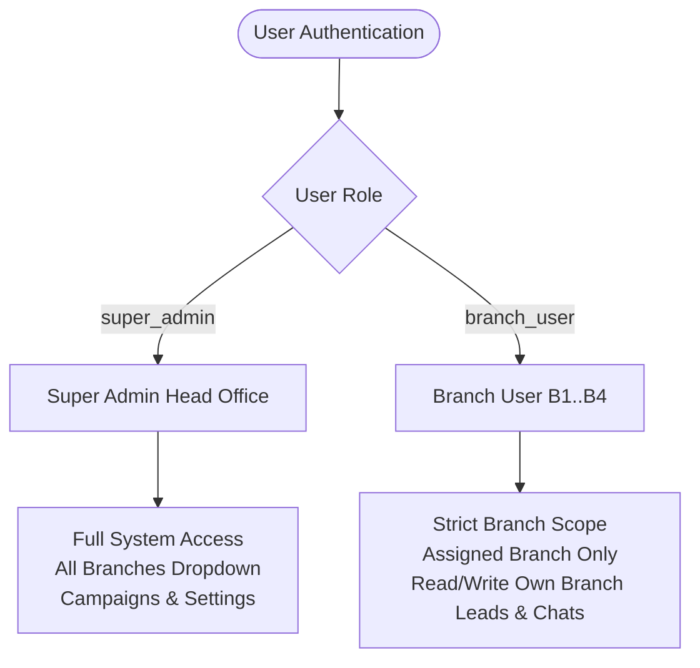

# RS Mens World — Backend Integration & API Handoff Specification

**Document Version:** 1.0.0  
**Target Release:** Phase 1 MVP  
**Design Authority:** Mint Green (`#A8F0D0`) & Deep Teal (`#004F4C`) Master Design System  
**Handoff Date:** November 2026  
**Audience:** Backend Engineering Team, API Architects, Database Engineers, DevOps  

---

## 1. Executive Summary & Architecture Scope

This specification provides the comprehensive contract between the completed **RS Mens World** React frontend and the incoming backend services. The frontend is architected as a modular Single Page Application (Vite + React 19 + Tailwind CSS) with a decoupled service tier (`src/services/`).

### 1.1 Strict Phase 1 Scope Boundary
Per the Product Requirement Document (PRD), the Phase 1 MVP is strictly restricted to:
1. **AI Chatbot Concierge & Staff Handover Inbox** (Website widget + Multi-branch staff response console).
2. **AI Lead Generation & Kanban Pipeline** (AI auto-qualification, 6-stage pipeline, branch routing).
3. **Customer Database & Petpooja POS CSV Importer** (Centralized directory, DPDP consent tracking, POS CSV deduplication).
4. **WhatsApp Broadcast Campaigns** (Branch-targeted marketing, Meta pre-approved template dispatch, consent filtering).
5. **Reports & Store Insights** (Conversion funnel, branch benchmarking, structured CSV exports).
6. **Multi-Branch Operations & RBAC** (Super Admin vs. Branch-scoped access across Rajahmundry B1 and B2–B4).
7. **System Configuration & Knowledge Base** (Store profile hours, FAQ knowledge base, API connector statuses).

> [!CAUTION]
> **Strict Out-of-Scope Enforcement:**  
> The backend team must **NOT** implement Point-of-Sale (POS) cash registers, barcode checkout, inventory stock management, warehouse logistics, stock transfers, billing/invoicing, or accounting in Phase 1. Petpooja remains the authoritative billing system; RS Mens World only imports customer contact records for marketing and engagement.

---

## 2. Frontend Component & Route Inventory

| Route Path | Page Component | Primary Subcomponents | RBAC Access |
|---|---|---|---|
| `/login` | `LoginPage.jsx` | Quick PIN Selector, PIN/Password Input, Security Notice | Public |
| `/access-denied` | `AccessDeniedPage.jsx` | 403 Forbidden Error Card, Switch Account CTA | Authenticated |
| `/` | `OverviewPage.jsx` | 5 Metric KPI Cards, Lead Flow Bar Chart, Branch Progress, Recent Activity Table, Quick Actions | All Roles (Branch Scoped) |
| `/chat-inbox` | `ChatInboxPage.jsx` | `StaffChatInbox.jsx` (Filter tabs, Message feed, Product Cards, Lead Drawer) | All Roles (Branch Scoped) |
| `/leads` | `LeadsPage.jsx` | `LeadKanbanBoard.jsx` (6 Stages), `LeadTable.jsx`, `LeadDetailDrawer.jsx`, `AddLeadModal.jsx` | All Roles (Branch Scoped) |
| `/customers` | `CustomersPage.jsx` | Status Tabs, Dense Table, Docked `CustomerDetailsPanel.jsx`, `AddCustomerModal.jsx`, `PetpoojaImportModal.jsx` | All Roles (Branch Scoped) |
| `/campaigns` | `CampaignsPage.jsx` | `CampaignWizardModal.jsx` (4 Steps), Branch Audience Matrix, Campaign Table | Super Admin Only |
| `/reports` | `ReportsPage.jsx` | Funnel Visualizer, Branch KPI Cards, 3 CSV Export Triggers | All Roles (Branch Scoped) |
| `/settings` | `SettingsPage.jsx` | Store Branches Tab, Users & Roles Tab, Knowledge Base Editor, Integration Status | Super Admin Only |

### Persistent Overlay Components
- `CustomerChatWidget.jsx`: Floating customer concierge widget mounted globally in `AppLayout.jsx` for testing instant AI answers, verified store policies, and staff handover.

---

## 3. Authentication & Session Architecture

### 3.1 Token Mechanism
- The frontend expects standard JSON Web Token (`JWT`) authentication.
- Upon successful authentication via `POST /api/auth/login`, the backend must return an `accessToken` and user profile object.
- All subsequent API requests from `src/services/apiClient.js` will include the Bearer token in the `Authorization` header:
  ```http
  Authorization: Bearer <jwt_access_token>
  X-Branch-ID: B1
  Content-Type: application/json
  ```

### 3.2 Role-Based Access Control (RBAC) Rules



1. **Super Admin (`super_admin`):**
   - Head Office oversight.
   - Access to all 4 branches via the global Branch Switcher (`activeBranchId: "ALL"` or `"B1"`..`"B4"`).
   - Permission to create campaigns, modify branch details, edit the AI Knowledge Base, and reset demo data.
2. **Branch User (`branch_user`):**
   - Restrict data queries to `currentUser.assignedBranchId`.
   - The backend **must enforce server-side row-level security** by inspecting the user's token or session branch ID, ignoring client attempts to query other branch IDs.
   - Access to `/settings` and `/campaigns` is restricted.

---

## 4. Provisional REST API Specifications

All endpoints are prefixed with `/api` (configurable via `VITE_API_BASE_URL`).

### 4.1 Branch Management
#### `GET /api/branches`
Returns all registered store branches.

**Response `200 OK`:**
```json
[
  {
    "id": "B1",
    "name": "Rajahmundry Main Store",
    "city": "Rajahmundry",
    "state": "Andhra Pradesh",
    "address": "Main Road, Near Syamala Theater, Rajahmundry - 533101",
    "phone": "+91 883 244 5566",
    "whatsappNumber": "+91 98480 12345",
    "hours": "10:00 AM – 9:30 PM (All 7 Days)",
    "enabled": true,
    "assignedStaff": ["USR-B1-01", "USR-B1-02"]
  },
  {
    "id": "B2",
    "name": "Kakinada Branch",
    "city": "Kakinada",
    "state": "Andhra Pradesh",
    "address": "Cinema Road, Kakinada - 533001",
    "phone": "+91 884 233 4455",
    "whatsappNumber": "+91 98480 12346",
    "hours": "10:00 AM – 9:30 PM",
    "enabled": true,
    "assignedStaff": ["USR-B2-01"]
  }
]
```

---

### 4.2 AI Chatbot & Staff Handover

#### `GET /api/chats?branchId={B1|ALL}&status={all|open|pending|closed}`
Returns active conversation threads for staff inbox.

**Response `200 OK`:**
```json
[
  {
    "id": "CHAT-1024",
    "channel": "whatsapp",
    "customer": {
      "name": "Rahul Kumar",
      "mobile": "+91 98765 43210",
      "avatar": null
    },
    "branchId": "B1",
    "branchName": "Branch 1 (Anna Nagar)",
    "status": "open",
    "lastMessage": "The blue one looks good. Is it available at your Anna Nagar store?",
    "lastMessageTime": "2026-11-18T10:27:00Z",
    "unreadCount": 0,
    "handoverRequested": false,
    "leadId": "L-3816",
    "messages": [
      {
        "id": "msg-01",
        "sender": "customer",
        "text": "Do you have formal shirts?",
        "timestamp": "2026-11-18T10:20:00Z"
      },
      {
        "id": "msg-02",
        "sender": "assistant",
        "text": "Yes, we have a new formal shirt collection starting from ₹1,299. Would you like to see some options?",
        "timestamp": "2026-11-18T10:22:00Z",
        "isAi": true
      },
      {
        "id": "msg-03",
        "sender": "customer",
        "text": "Please share a few options in size L.",
        "timestamp": "2026-11-18T10:23:00Z"
      },
      {
        "id": "msg-04",
        "sender": "assistant",
        "text": "Here are some formal shirts in size L. Let me know which one you like.",
        "timestamp": "2026-11-18T10:25:00Z",
        "productCards": [
          {
            "id": "prod-1",
            "name": "Classic White Slim Fit",
            "price": "₹1,499",
            "imageUrl": "https://images.unsplash.com/photo-1602810318383-e386cc2a3ccf?w=300"
          },
          {
            "id": "prod-2",
            "name": "Sky Blue Oxford Shirt",
            "price": "₹1,699",
            "imageUrl": "https://images.unsplash.com/photo-1596755094514-f87e34085b2c?w=300"
          }
        ]
      }
    ]
  }
]
```

#### `POST /api/chats/{id}/messages`
Send staff reply into conversation thread.
**Request Body:**
```json
{
  "text": "Hello Rahul, yes the Sky Blue shirt in size L is reserved for you at our Anna Nagar branch counter.",
  "senderId": "USR-B1-01"
}
```

#### `POST /api/chats/{id}/handover`
Requests human staff intervention or transfers conversation.
**Request Body:**
```json
{
  "reason": "Customer requested in-store tailoring measurement appointment",
  "targetBranchId": "B1"
}
```

---

### 4.3 Lead Generation & Pipeline

#### `GET /api/leads?branchId={B1|ALL}&stage={New|Contacted|Qualified|Follow-up|Converted|Lost}&search={query}`
Returns filtered leads for Kanban board and table views.

**Response `200 OK`:**
```json
[
  {
    "id": "L-3816",
    "name": "Priya Sharma",
    "mobile": "+91 98450 12345",
    "email": "priya.s@example.com",
    "enquiry": "Offer details and pricing for festive collection",
    "preferredBranchId": "B1",
    "assignedBranchId": "B1",
    "branchName": "Branch 1 (Anna Nagar)",
    "stage": "Follow-up",
    "priority": "HIGH",
    "tags": ["Formal Wear", "Offer"],
    "followUpDate": "2026-11-20",
    "notes": "Interested in festive collection. Share latest offers and available sizes.",
    "source": "AI Chat",
    "createdAt": "2026-11-18T08:30:00Z"
  }
]
```

#### `POST /api/leads`
Create a new lead (from AI Chatbot, Concierge widget, or Manual modal).

**Request Body:**
```json
{
  "name": "Rohit Verma",
  "mobile": "+91 98765 00001",
  "email": "rohit.v@example.com",
  "enquiry": "Men's wedding wear collection",
  "preferredBranchId": "B1",
  "source": "AI Chat",
  "consentToContact": true,
  "tags": ["Wedding", "Sherwani"]
}
```

**Response `201 Created`:**
```json
{
  "id": "L-3820",
  "name": "Rohit Verma",
  "mobile": "+91 98765 00001",
  "stage": "New",
  "priority": "HIGH",
  "aiSummary": "High-intent inquiry for wedding sherwanis and ethnic suits",
  "createdAt": "2026-11-18T10:45:00Z"
}
```

#### `PUT /api/leads/{id}/stage`
Update lead stage upon Kanban drag-and-drop.
**Request Body:**
```json
{
  "stage": "Converted",
  "notes": "Customer visited Anna Nagar store and purchased wedding sherwani."
}
```

---

### 4.4 Customer Database & Petpooja POS Import

#### `GET /api/customers?branchId={B1|ALL}&status={All|New|Active|Inactive}&consent={All|Yes|No}&search={query}&page=1&limit=10`
Returns paginated customer database matching approved reference screen.

**Response `200 OK`:**
```json
{
  "total": 2486,
  "page": 1,
  "limit": 10,
  "counts": {
    "all": 2486,
    "new": 684,
    "active": 1642,
    "inactive": 160
  },
  "customers": [
    {
      "id": "C-10248",
      "name": "Rahul Kumar",
      "phone": "+91 98765 43210",
      "email": "rahul.kumar@gmail.com",
      "branchId": "B1",
      "branchName": "Branch 1 (Anna Nagar)",
      "consent": true,
      "customerType": "Regular",
      "status": "Active",
      "customerSince": "2024-03-15",
      "lastInteraction": "Nov 18, 2025",
      "purchaseSummary": {
        "totalPurchases": 24560,
        "totalPurchasesFormatted": "₹24,560",
        "ordersCount": 12,
        "avgOrderValue": 2047,
        "avgOrderValueFormatted": "₹2,047"
      }
    }
  ]
}
```

#### `POST /api/customers/import/validate`
Upload CSV for validation prior to saving.
**Request Payload:** `multipart/form-data` with CSV file and column mappings.
**Response `200 OK`:**
```json
{
  "totalRows": 250,
  "validCount": 238,
  "invalidCount": 2,
  "duplicateCount": 10,
  "invalidSamples": [
    { "row": 14, "reason": "Invalid 10-digit mobile number: 9876" }
  ],
  "duplicateSamples": [
    { "name": "Kiran Das", "mobile": "+91 98450 12345", "existingCustomerId": "C-1002" }
  ]
}
```

#### `POST /api/customers/import/confirm`
Commit validated customer records into database.
**Request Body:**
```json
{
  "importBatchId": "batch-20261118-01",
  "targetBranchId": "B1",
  "defaultConsent": true,
  "records": [
    {
      "name": "Anita Joshi",
      "mobile": "+91 99654 32109",
      "email": "anita.j@example.com",
      "branchId": "B2",
      "marketingOptIn": true,
      "consentSource": "Petpooja POS Invoice Opt-in",
      "consentDate": "2026-11-18"
    }
  ]
}
```

---

### 4.5 WhatsApp Campaigns

#### `GET /api/campaigns`
Returns all created broadcasts with delivery performance.

**Response `200 OK`:**
```json
[
  {
    "id": "CMP-904",
    "title": "Festive Wedding Season 20% Off",
    "templateId": "rs_festive_offer_v1",
    "status": "SCHEDULED",
    "enabledBranchIds": ["B1", "B2"],
    "audienceSummary": {
      "totalAudience": 1240,
      "optedInAudience": 1240,
      "suppressedOptOut": 160
    },
    "deliveryCounts": {
      "sent": 0,
      "delivered": 0,
      "read": 0,
      "failed": 0
    },
    "scheduleAt": "2026-11-20T10:00:00Z",
    "createdAt": "2026-11-18T14:00:00Z"
  }
]
```

#### `POST /api/campaigns`
Creates and schedules a new broadcast campaign.
**Request Body:**
```json
{
  "title": "Winter Blazers & Suits Launch",
  "templateId": "winter_collection_announcement",
  "branchIds": ["B1", "B2", "B3", "B4"],
  "targetAudience": "ACTIVE_30_DAYS",
  "scheduleType": "SCHEDULED",
  "scheduleAt": "2026-11-25T11:00:00Z"
}
```

---

### 4.6 Reports & Analytics

#### `GET /api/reports/kpis?branchId={B1|ALL}&period={7d|30d|90d}`
Returns aggregate KPI cards and conversion metrics.

**Response `200 OK`:**
```json
{
  "totalEnquiries": 2486,
  "leadsGenerated": 684,
  "qualifiedLeads": 412,
  "convertedSales": 160,
  "conversionRate": "23.4%",
  "activeCustomers": 1642,
  "broadcastReadRate": "68%",
  "branchPerformance": [
    { "branchId": "B1", "name": "Anna Nagar", "leads": 280, "converted": 72 },
    { "branchId": "B2", "name": "Kukatpally", "leads": 190, "converted": 44 },
    { "branchId": "B3", "name": "Madhapur", "leads": 130, "converted": 28 },
    { "branchId": "B4", "name": "Gachibowli", "leads": 84, "converted": 16 }
  ]
}
```

---

## 5. Mock-to-Live Migration Checklist

To switch the React frontend from mock prototype mode to live backend mode:

1. **Environment Configuration:**
   Create `.env.production` (or edit `.env`):
   ```env
   # Set to false to disable mockStorage and route all requests through apiClient
   VITE_USE_MOCKS=false
   
   # Set backend API root
   VITE_API_BASE_URL=https://api.rsmensworld.com/api
   ```
2. **CORS Headers Required from Backend:**
   ```http
   Access-Control-Allow-Origin: https://app.rsmensworld.com
   Access-Control-Allow-Methods: GET, POST, PUT, DELETE, OPTIONS
   Access-Control-Allow-Headers: Content-Type, Authorization, X-Branch-ID
   ```
3. **HTTP Status Code Expectations:**
   - `200 OK` / `201 Created`: Standard success with JSON body.
   - `400 Bad Request`: Validation failure. Body: `{ "message": "Invalid mobile format" }`.
   - `401 Unauthorized`: Invalid or expired JWT. Frontend automatically clears session and navigates to `/login`.
   - `403 Forbidden`: Insufficient role (e.g. Branch User accessing `/settings`). Frontend navigates to `/access-denied`.
   - `404 Not Found`: Entity not found. Body: `{ "message": "Lead not found" }`.
   - `500 Internal Server Error`: Generic failure toast triggered via `ToastContext`.

---

## 6. Regulatory & DPDP Act Compliance Requirements

1. **Explicit Marketing Consent (DPDP Act 2023):**
   - The customer record stores `consent: boolean`, `consentSource: string`, and `consentDate: string`.
   - When triggering campaigns, the backend **must execute strict server-side exclusion** of customers with `marketingOptIn == false`.
2. **Opt-Out Handling:**
   - Any WhatsApp incoming message containing "STOP", "UNSUBSCRIBE", or "OPTOUT" must automatically set `marketingOptIn = false` in the customer record and suppress subsequent campaign broadcasts.

---

**Specification End — Ready for Backend Implementation**
