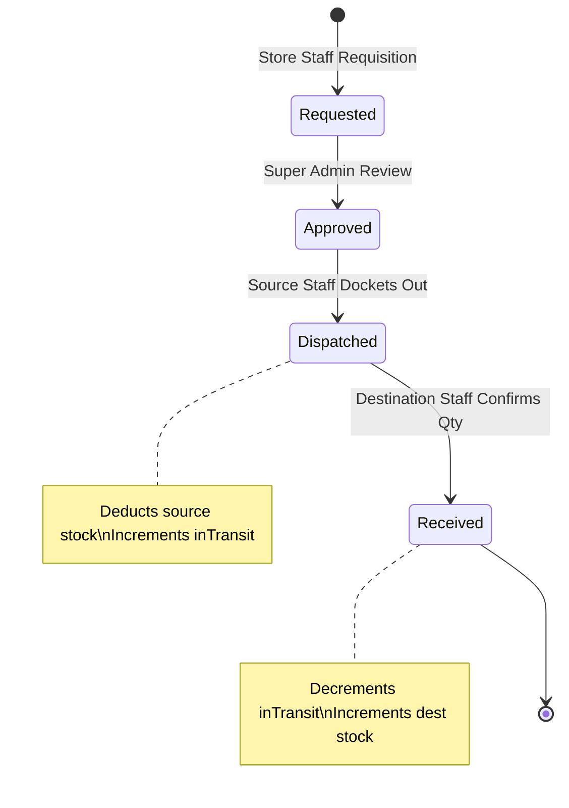

# RS Mens World — Retail ERP Backend Integration & API Handoff Specification

**Document Version:** 2.0.0 (Retail ERP Expansion)  
**Date:** November 2026  
**Audience:** Backend Development Team, API Architects, Database Engineers, Integration QA  
**Design System Authority:** Mint Green (`#A8F0D0`) & Deep Teal (`#004F4C`) Master Design System  

---

## 1. Executive Summary & Architectural Scope

This specification provides the comprehensive data contracts, business rules, and API endpoints for the completed **Retail ERP frontend expansion** of RS Mens World. The frontend now encompasses both **Customer Engagement** and **Retail Operations** under a unified Single Page Application (Vite + React 19).

### Complete Modules Inventory

| Group | Route Path | Page Component | Primary Capabilities |
|---|---|---|---|
| **Operations** | `/` | `OverviewPage.jsx` | Head Office & Branch-wise KPI analytics, lead velocity, branch benchmarks |
| **Operations** | `/pos` | `PosPage.jsx` | Real-time POS checkout, barcode scan, cart tax calculation, split payments, hold bill, tax invoices |
| **Operations** | `/invoices` | `InvoicesPage.jsx` | Historical sales transactions, printable invoice receipts, 7-day sales returns |
| **Inventory** | `/inventory` | `InventoryPage.jsx` | Garment SKU master, variant matrix (size/colour), branch stock levels, stock adjustments, perpetual movement ledger |
| **Inventory** | `/transfers` | `TransfersPage.jsx` | Inter-branch requisitions, dispatch dockets, in-transit tracking, and receipt verification |
| **Finance** | `/accounting` | `AccountingPage.jsx` | General ledger, cash/bank flows, customer credit tracking, and day-end cash register closings |
| **Customer Engagement** | `/chat-inbox` | `ChatInboxPage.jsx` | 3-column staff chat inbox, customer handover, AI product suggestions, instant lead creation |
| **Customer Engagement** | `/leads` | `LeadsPage.jsx` | 6-stage Kanban board, table view, docked lead details, WhatsApp trigger |
| **Customer Engagement** | `/customers` | `CustomersPage.jsx` | Reference-accurate customer directory, Petpooja POS CSV import wizard, purchase summary |
| **Customer Engagement** | `/campaigns` | `CampaignsPage.jsx` | 3 subtabs (Broadcasts, Meta templates, DPDP consent & suppression), dispatch log inspector |
| **Control** | `/reports` | `ReportsPage.jsx` | Funnel visualizer, branch benchmarking, 3 structured CSV downloads |
| **Control** | `/settings` | `SettingsPage.jsx` | 5 subtabs (Branches, Users & Roles, Knowledge Base, WhatsApp APIs, System Audit Trail) |

---

## 2. Retail ERP Core Data Models

### 2.1 Product Master (`products`)
```json
{
  "id": "p_0001",
  "sku": "SHT-001-WHI-39",
  "barcode": "8901000007919",
  "name": "Oxford Button-Down Shirt",
  "category": "Shirts",
  "brand": "RS Signature",
  "size": "39",
  "colour": "White",
  "cost": 720,
  "price": 1499,
  "gst": 5,
  "active": true
}
```

### 2.2 Branch Stock Inventory (`stock`)
```json
{
  "id": "B1__p_0001",
  "branch": "B1",
  "productId": "p_0001",
  "qty": 18,
  "damaged": 0,
  "min": 5,
  "inTransit": 0
}
```

### 2.3 Sales Invoice (`invoices`)
```json
{
  "id": "inv_1001",
  "invoiceNo": "RJY-2026-0842",
  "branch": "B1",
  "date": "2026-11-18T16:30:00Z",
  "customerId": "C-10248",
  "customerName": "Rahul Kumar",
  "customerMobile": "+91 98765 43210",
  "items": [
    {
      "productId": "p_0001",
      "name": "Oxford Button-Down Shirt",
      "size": "39",
      "colour": "White",
      "sku": "SHT-001-WHI-39",
      "qty": 1,
      "price": 1499,
      "gstRate": 5,
      "gstAmount": 71.38,
      "total": 1499
    }
  ],
  "subtotal": 1427.62,
  "gstTotal": 71.38,
  "discount": 0,
  "total": 1499,
  "payments": [
    { "mode": "UPI", "amount": 1499 }
  ],
  "status": "Paid",
  "cashier": "B1 Staff (Rajahmundry)"
}
```

### 2.4 Stock Movement Ledger (`movements`)
```json
{
  "id": "mov_101",
  "date": "2026-11-18T16:30:00Z",
  "branch": "B1",
  "productId": "p_0001",
  "productName": "Oxford Button-Down Shirt (White / 39)",
  "type": "Sale",
  "qty": -1,
  "balance": 17,
  "reference": "Invoice RJY-2026-0842",
  "user": "B1 Staff"
}
```

### 2.5 Inter-Branch Transfer (`transfers`)
```json
{
  "id": "TRF-2026-001",
  "createdDate": "2026-11-16T14:30:00Z",
  "from": "B1",
  "fromName": "Rajahmundry Main Store",
  "to": "B2",
  "toName": "Kakinada Branch",
  "status": "Dispatched",
  "items": [
    {
      "productId": "p_0009",
      "name": "Single-Breasted Italian Blazer",
      "sku": "BLZ-009-NAV-40",
      "qty": 2,
      "receivedQty": 0
    }
  ],
  "requestedBy": "Branch 2 User",
  "approvedBy": "Super Admin",
  "dispatchedDate": "2026-11-16T16:00:00Z",
  "receivedDate": null,
  "notes": "Wedding season trial stock requisition"
}
```

### 2.6 Day-End Register Closing (`closings`)
```json
{
  "id": "cls_20261117_B1",
  "date": "2026-11-17",
  "branch": "B1",
  "openingCash": 5000,
  "cashSales": 18450,
  "cardSales": 24500,
  "upiSales": 31200,
  "creditSales": 4500,
  "expenses": 1200,
  "expectedCash": 22250,
  "closingCash": 22250,
  "variance": 0,
  "closedBy": "B1 Staff",
  "notes": "Reconciled against counter till receipts"
}
```

---

## 3. Retail Inventory & Transaction Rules

The backend services must strictly enforce the following state transition guarantees:



### Rule 1: Point-of-Sale Checkout
When `POST /api/pos/checkout` is invoked:
1. Atomically verify that all cart items have `stock.qty >= item.qty` in the billing branch.
2. Deduct `item.qty` from the billing branch's inventory record.
3. Automatically append a record to `movements` with `type: 'Sale'`, `qty: -item.qty`, and reference `Invoice <invoiceNo>`.
4. Automatically append an income entry to `ledger` with `category: 'Store Sales (POS)'`.
5. Persist the invoice with status `Paid` (or `Credit` if payment mode is Store Credit).

### Rule 2: Sales Returns & Exchanges
When `POST /api/returns` is invoked:
1. Update invoice status to `Returned`.
2. If `restock == true`:
   - Increment the returned item quantity back into the branch's `stock.qty`.
   - Append a record to `movements` with `type: 'Return'`, `qty: +item.qty`.
3. Append an expense entry to `ledger` with `category: 'Sales Return Refund'` and the selected refund mode (`Store Credit Note`, `Cash`, `UPI`).

### Rule 3: Inter-Branch Stock Transfers
1. **Creation (`POST /api/transfers`):** Status is set to `Requested`. Source and destination cannot be the same.
2. **Approval (`PUT /api/transfers/{id}/status` with `status: 'Approved'`):** Authorized by Super Admin.
3. **Dispatch (`PUT /api/transfers/{id}/status` with `status: 'Dispatched'`):** 
   - Deducts quantities from source branch `stock.qty`.
   - Increments destination branch `stock.inTransit`.
   - Records `Transfer Out` movement at source.
4. **Receipt (`PUT /api/transfers/{id}/status` with `status: 'Received'`):**
   - Decrements destination branch `stock.inTransit`.
   - Increments destination branch `stock.qty` by `receivedQty`.
   - Records `Transfer In` movement at destination.

### Rule 4: Day-End Register Closing Formula
$$\text{Expected Closing Cash} = \text{Opening Cash Drawer} + \text{Total Cash Sales} - \text{Total Cash Expenses}$$
$$\text{Variance} = \text{Physical Counted Cash} - \text{Expected Closing Cash}$$
The backend must store the computed variance and flag any non-zero amounts for Super Admin audit review.

---

## 4. Proposed REST API Endpoints Specification

### 4.1 Product Catalogue (`/api/products`)
- `GET /api/products?category={cat}&search={q}`: Returns list of active garment products.
- `GET /api/products/{id}`: Returns product details by ID.
- `POST /api/products`: Create a new product master record.
- `PUT /api/products/{id}`: Update product details, cost, retail MRP, and GST.

### 4.2 Branch Inventory (`/api/inventory`)
- `GET /api/inventory/stock?branchId={B1|ALL}`: Returns branch-wise stock balances.
- `POST /api/inventory/adjust`: Record physical count adjustment (+/- qty, reason, user).
- `GET /api/inventory/movements?branchId={B1|ALL}&type={Sale|Adjustment|Transfer|Return}`: Returns perpetual stock movement ledger.
- `GET /api/inventory/summary?branchId={B1|ALL}`: Aggregate stats (Total SKUs, Total Units, Inventory Cost Valuation, Low Stock Alerts).

### 4.3 Billing & POS (`/api/pos`)
- `POST /api/pos/checkout`: Execute sale transaction, decrement stock, and issue tax invoice.
- `GET /api/pos/invoices?branchId={B1|ALL}&status={Paid|Credit|Returned}&search={q}`: Returns invoice history.
- `GET /api/pos/invoices/{id}`: Returns invoice details and line items for receipt reprint.

### 4.4 Sales Returns (`/api/returns`)
- `GET /api/returns?branchId={B1|ALL}`: Returns processed returns history.
- `POST /api/returns`: Process customer garment return, issue credit/cash refund, and restock.

### 4.5 Stock Transfers (`/api/transfers`)
- `GET /api/transfers?branchId={B1|ALL}&status={Requested|Approved|Dispatched|Received}`: Returns transfers list.
- `POST /api/transfers`: Create new requisition docket.
- `PUT /api/transfers/{id}/status`: Transition transfer lifecycle (`Approved`, `Dispatched`, `Received`).

### 4.6 Accounting & Ledgers (`/api/accounting`)
- `GET /api/accounting/ledger?branchId={B1|ALL}&type={Income|Expense}`: Returns general ledger entries.
- `POST /api/accounting/ledger`: Record new income or expense voucher.
- `GET /api/accounting/closings?branchId={B1|ALL}`: Returns daily register closing records.
- `POST /api/accounting/closings`: Record day-end register reconciliation.
- `GET /api/accounting/summary?branchId={B1|ALL}`: Returns total income, total expenses, net margin, and customer outstanding credit.

---

## 5. Mock-to-Live Migration Checklist

The frontend architecture cleanly decouples UI views from mock data via `src/services/`. To switch to live backend APIs:

1. In `.env`:
   ```env
   VITE_USE_MOCKS=false
   VITE_API_BASE_URL=https://api.rsmensworld.com/api
   ```
2. The `apiClient.js` automatically passes:
   ```http
   Authorization: Bearer <jwt_token>
   X-Branch-ID: B1
   Content-Type: application/json
   ```
3. Backend engineers can implement each controller independently according to the JSON schemas defined above without breaking existing frontend views.

---

**Specification End — Approved for Backend Implementation**
