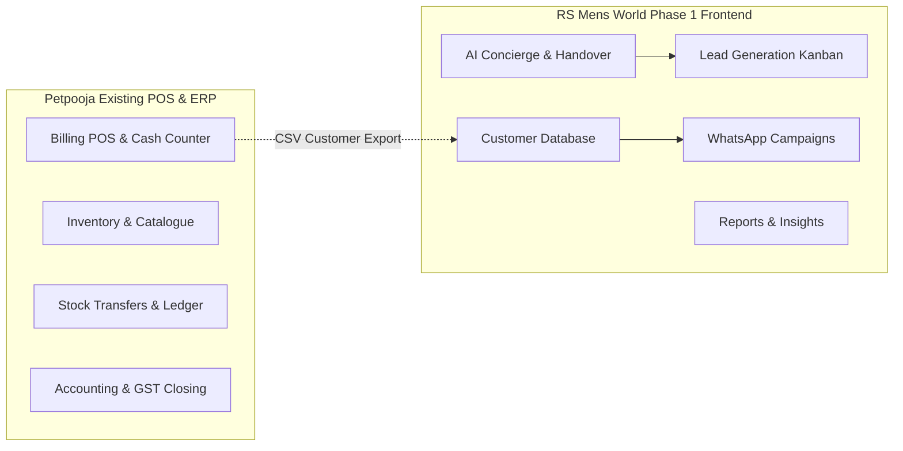

# RS Mens World — Retail Scope Comparison & Architectural Boundary

**Document Version:** 1.0.0  
**Date:** November 2026  
**Subject:** Comparative Analysis of Claude Reference Prototype (`docs/design.html`) vs. Approved Phase 1 PRD Scope  
**Author:** Senior React Frontend Engineer & QA Integration Architect  
**Audience:** Project Stakeholders, Product Management, Backend Engineers, Frontend Engineers  

---

## 1. Executive Summary

The Claude reference prototype (`docs/design.html`) represents a monolithic retail ERP covering Point-of-Sale (POS), inventory warehousing, stock transfers, accounting ledgers, and customer engagement. 

However, per the **RS Mens World Product Requirement Document (PRD)** and executive directive, the **Phase 1 MVP is strictly focused on the AI Customer Engagement & Branch Growth Platform**.

This document details the exact module-by-module comparison, delineates the excluded retail modules, and documents the operational interface between RS Mens World and the store's existing **Petpooja POS** system.

---

## 2. Module Comparison Matrix

| Claude Reference Group (`docs/design.html`) | Reference View Key | Phase 1 PRD Status | System of Record | Notes & Operational Scope |
|---|---|---|---|---|
| **Operations** | `dashboard` | **INCLUDED (Phase 1)** | RS Mens World | Multi-branch overview, engagement KPIs, lead pipeline flow, and quick actions. |
| **Operations** | `pos` (Billing POS) | **EXCLUDED (Phase 1)** | **Petpooja POS** | Cash counter, barcode scanning, checkout, and receipt printing stay in Petpooja. |
| **Operations** | `invoices` (Returns) | **EXCLUDED (Phase 1)** | **Petpooja POS** | Tax invoice generation, credit notes, and item returns stay in Petpooja. |
| **Inventory** | `inventory` (Catalogue) | **EXCLUDED (Phase 1)** | **Petpooja POS** | SKUs, barcode registry, cost prices, and physical stock counts stay in Petpooja. |
| **Inventory** | `transfers` (Transfers) | **EXCLUDED (Phase 1)** | **Petpooja POS** | Inter-branch dispatch, transit tracking, and discrepancy resolution stay in Petpooja. |
| **Inventory** | `movements` (Ledger) | **EXCLUDED (Phase 1)** | **Petpooja POS** | Stock movement auditing and inventory valuation stay in Petpooja. |
| **Finance** | `accounts` (Accounting) | **EXCLUDED (Phase 1)** | **Petpooja / Tally** | Daily cash closing, supplier ledgers, GST CGST/SGST tax filings stay in external accounting. |
| **Customers** | `customers` (Directory) | **INCLUDED (Phase 1)** | RS Mens World | Centralized directory, DPDP consent tracking, and Petpooja CSV contact import. |
| **Customers** | `whatsapp` (Campaigns) | **INCLUDED (Phase 1)** | RS Mens World | Branch-targeted broadcasts, Meta pre-approved templates, consent filtering. |
| **Customers** | `leads` (Lead Gen) | **INCLUDED (Phase 1)** | RS Mens World | 6-stage Kanban board, AI qualification, branch routing, and staff follow-ups. |
| **Customers** | `assistant` (AI Chatbot) | **INCLUDED (Phase 1)** | RS Mens World | Website concierge, verified FAQ answers, and staff handover console. |
| **Control** | `reports` (Analytics) | **INCLUDED (Phase 1)** | RS Mens World | Lead conversion funnel, campaign performance, and DPDP consent audit exports. |
| **Control** | `audit` (Audit Log) | **INCLUDED (Phase 1)** | RS Mens World | Operational log of staff logins, imports, broadcasts, and pipeline updates. |
| **Control** | `settings` (Branches/Users)| **INCLUDED (Phase 1)** | RS Mens World | Branch addresses, phone numbers, RBAC directory, knowledge base FAQ management. |

---

## 3. Detailed Specification of Excluded Retail Modules

The following five retail modules observed in the Claude reference prototype are **strictly out of scope for Phase 1**:

### 3.1 Point-of-Sale (POS) Billing Register (`VIEWS.pos`)
- **Reference Capabilities:** Item barcode search, cart calculation, discount overrides, cash/UPI/credit payment modes, invoice generation, customer credit billing, and receipt modal (`MODALS.receipt`).
- **Exclusion Justification:** RS Mens World physical retail counters already utilize Petpooja POS terminals with thermal receipt printers and barcode hardware. Implementing a second web POS creates operational confusion and checkout delays for floor sales staff.

### 3.2 Invoices & Returns Management (`VIEWS.invoices`)
- **Reference Capabilities:** Invoice history, line-item returns, credit note issuances (`MODALS.invoice`), and GST tax breakdowns.
- **Exclusion Justification:** Tax-compliant GST sales receipts must be generated from the authoritative billing engine (Petpooja) for statutory filing.

### 3.3 Inventory Stock & Catalogue Management (`VIEWS.inventory`)
- **Reference Capabilities:** Master SKU catalogue (`MODALS.product`), size/colour variant matrix, purchase cost vs. retail MRP, minimum reorder alerts, stock count adjustments (`invAdjust`), and physical reconciliation (`MODALS.stock`).
- **Exclusion Justification:** Real-time multi-branch inventory tracking requires barcode scanner synchronization and warehouse integrations slated for Phase 2. The AI assistant in Phase 1 provides general collection availability guidance and routes specific size/stock enquiries to store staff.

### 3.4 Inter-Branch Stock Transfers (`VIEWS.transfers`, `VIEWS.movements`)
- **Reference Capabilities:** Inter-branch transfer requests (`MODALS.newTransfer`), dispatch sign-offs, transit tracking, receipt variance confirmations, and perpetual movement ledgers.
- **Exclusion Justification:** Warehouse logistics and physical inter-store transfer dockets remain managed through Petpooja back-office tools.

### 3.5 Financial Accounting & Day-End Closing (`VIEWS.accounts`)
- **Reference Capabilities:** Day-end cash drawer closure (`accClosing`), supplier accounts payable, ledger journal entries (`MODALS.entry`), and GST filing summary cards (CGST + SGST).
- **Exclusion Justification:** Retail financial accounting is managed through Petpooja's accounting export into Tally/ERP.

---

## 4. The Petpooja POS Integration Boundary

Rather than duplicating billing registers, the interaction between Petpooja and RS Mens World Phase 1 is cleanly decoupled:

1. **Inbound Data (Customer Contact Import):**
   - Store managers export their daily or weekly customer sales report from Petpooja POS in CSV / Excel format.
   - The CSV is uploaded into RS Mens World via `CustomersPage.jsx` -> `PetpoojaImportModal.jsx`.
   - The frontend validates mobile numbers (10-digit Indian standard), detects duplicate contacts against existing records, captures marketing opt-in consent, and assigns the customers to their respective store branch.
2. **Outbound Value (Store Footfall & Conversion):**
   - The AI Chatbot and WhatsApp campaigns generate qualified customer leads with specific garment interests.
   - Branch staff invite customers into the physical store for bespoke fittings.
   - Final garment checkout and payment processing happen at the Petpooja cash register.

---

## 5. Architectural Recommendations for Backend Team

1. **Database Schema:** Model tables strictly for `branches`, `users`, `chats`, `leads`, `customers`, `campaigns`, `knowledge_base`, and `audit_logs`. Do not design tables for warehouse stock, transfers, or POS carts in Phase 1.
2. **Provisional Endpoints:** Implement the endpoints specified in `docs/BACKEND_HANDOFF.md`.
3. **Environment Flags:** Maintain the `VITE_USE_MOCKS=false` configuration in `.env` to route requests to backend API microservices seamlessly.

---

**Document End — Approved for Phase 1 Frontend Delivery**
